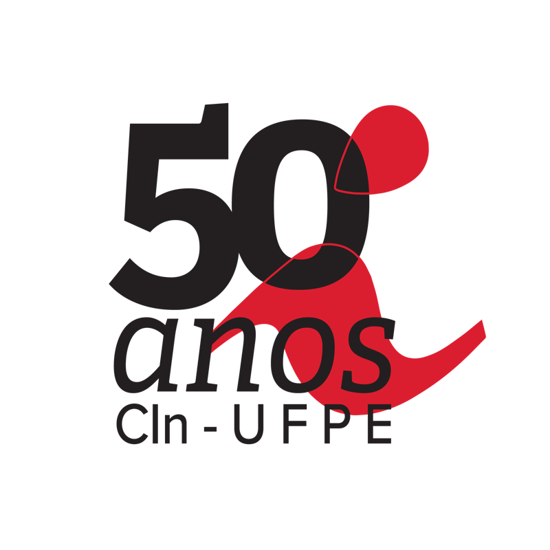

<!--Capsule render cima-->
<p align="center">
  
</p>

<!-- Bloco das Imagens Lado a Lado -->
<table align="center" border="0" cellpadding="0" cellspacing="0" style="border-collapse: collapse; border: none;">
  <tr>
    <td style="border: none; padding-right: 50px;">
      
    </td>
    <td style="border: none;">
      
    </td>
  </tr>
</table>

---

<!-- Título e disciplina -->
<h1 align="center" style="border-bottom: none !important; padding-bottom: 0 !important; margin-top: 20px;">Frequência UFPE — Controle de Frequência Acadêmica</h1>
<h3 align="center" style="border-bottom: none !important; padding-bottom: 0 !important; color: #666;">Desenvolvimento de Software — Grupo 8 · Projeto P07 (UFPE, 2026.2) <!-- [CONFIRMAR] nome/código da disciplina --></h3>
<br>

<!--Capsule render cima área do sumário e resumo-->
<p align="center">
  
</p>

<h2 style="border-bottom: none !important; padding-bottom: 0 !important;"> Sumário</h2>

* [Resumo do Projeto](#resumo)
* [Guia de Instalação](#guia-de-instalacao)
* [Arquitetura do Projeto](#arquitetura-do-projeto)
* [API e Modelo de Dados](#api-e-modelo-de-dados)
* [Qualidade e Testes](#qualidade-e-testes)
* [Tecnologias Utilizadas](#tecnologias-utilizadas)
* [Equipe](#equipe-desenvolvimento)

---

<a id="resumo"></a>
<h2 style="border-bottom: none !important; padding-bottom: 0 !important;"> Resumo</h2>

> Projeto de **Desenvolvimento de Software** do **Grupo 8**, que implementa um **sistema de controle de frequência acadêmica** com três perfis: **Professor**, **Aluno** e **Administrador**.
>
> O professor **abre uma chamada** para uma turma com validade de **1 a 120 minutos**, gerando um **código compartilhado** que pode ser **projetado em tela cheia**. O aluno **registra a presença digitando o código** dentro do prazo, com **uma presença por aluno em cada chamada**. Depois de encerrada, o professor ainda pode **corrigir presença ou falta**. A frequência do aluno é calculada **somente sobre chamadas encerradas**: sem registro, a chamada conta como falta; chamadas abertas aparecem como pendentes.
>
> A solução é dividida em um **frontend** em **React + TypeScript + Vite** (`p07-frontend`) e um **backend** em **NestJS + Prisma + PostgreSQL** (`backend`), com **autenticação via Keycloak (OIDC, Authorization Code + PKCE)**. O backend valida o **JWT (assinatura via JWKS, issuer e audience)** e restringe o acesso por **papel e vínculo com a turma**. Abertura, registro, correção e encerramento usam **transação e bloqueio da turma**, e um **índice parcial** garante no máximo uma chamada aberta por turma.
>
> O frontend funciona em **modo demonstração** (dados fictícios, sem banco nem Keycloak) ou em **modo Keycloak** (API real), escolhido por configuração explícita.
>
> A entrega registra a **Sprint 3**: suítes de teste (v1 e v2), matriz de rastreabilidade, **tabela de dívida técnica**, **três refatorações** com testes antes e depois, **manual do desenvolvedor** e a **integração frontend × backend** com evidências.

---

<!--Capsule render cima área do guia de instalação-->
<p align="center">
  
</p>

<a id="guia-de-instalacao"></a>
<h2 style="border-bottom: none !important; padding-bottom: 0 !important;"> Guia de Instalação</h2>

> **Ambiente de Execução:** **Node.js 22.12+** (validado em Node 24 LTS) e **npm**. O backend usa PostgreSQL e Keycloak, disponíveis via Docker Compose.

### Pré-requisitos do Sistema
* **Node.js 22.12+** (o backend define `22` no `.nvmrc`)
* **Git** (para clonagem do repositório)
* **npm** (gerenciador de pacotes)
* **Docker** e **Docker Compose** (para PostgreSQL e Keycloak, apenas no modo integrado)

### Passo a Passo

#### Passo 1: Clone o Repositório
```bash
git clone https://github.com/mateuscresp/DS-G8-Frequencia.git
cd DS-G8-Frequencia
```

#### Passo 2: Rode o Frontend em Modo Demonstração (mais rápido)
```bash
cd p07-frontend
npm ci
npm run dev
```
Abra a URL exibida pelo Vite. Escolha **Professor**, selecione uma turma e gere um código. Use **Projetar** para mostrar o código em tela cheia. Em outra aba da mesma origem, abra `/aluno`, digite o código e volte à aba do professor para conferir o registro.

> A demonstração usa **dados fictícios** e sincroniza pelo armazenamento local do navegador. Sem `.env`, o modo padrão é `demo`.

#### Passo 3: Suba o Modo Integrado (API + Keycloak)

**3.1 Infraestrutura (PostgreSQL e Keycloak):**
```bash
cd backend
docker compose up -d
```

**3.2 Keycloak:** crie o realm `p07-frequencia`, os papéis `p07-admin`, `p07-professor` e `p07-student`, e um cliente público OIDC `p07-front` (Authorization Code + PKCE, com redirect URI e web origin do frontend). Configure o token para incluir `p07-back` em `aud`. **Nunca coloque segredo de cliente em variáveis `VITE_*`.**

**3.3 Backend:**
```bash
cp .env.example .env
npm ci
npm run prisma:generate
npm run migration:run     # em banco novo (veja MIGRATION-NOTES.md se o banco já existir)
npm run db:seed           # cria apenas os status (não cria usuários nem turmas)
npm run dev
```

**3.4 Vínculos acadêmicos:** cadastre os `sub` do Keycloak em `Teacher`/`Student` e os vínculos `ClassTeacher`/`Enrollment`.

**3.5 Frontend em modo Keycloak:**
```bash
cd ../p07-frontend
cp .env.example .env.local
# defina VITE_APP_MODE=keycloak e revise VITE_API_URL, VITE_KEYCLOAK_JSON e os papéis
npm run dev
```

#### Variáveis de Ambiente Principais
| Local | Variável | Descrição |
|---|---|---|
| `backend/.env` | `DATABASE_URL` | Conexão PostgreSQL (padrão: porta `5433`) |
| `backend/.env` | `KEYCLOAK_AUTH_SERVER_URL`, `KEYCLOAK_REALM`, `KEYCLOAK_CLIENT_ID` | Validação do JWT (cliente esperado: `p07-back`) |
| `backend/.env` | `CORS_ORIGINS` | Origens do frontend permitidas |
| `backend/.env` | `API_PREFIX` | Prefixo da API (`frequencia/api`) |
| `p07-frontend/.env.local` | `VITE_APP_MODE` | `demo` (padrão) ou `keycloak` |
| `p07-frontend/.env.local` | `VITE_API_URL`, `VITE_KEYCLOAK_JSON` | API e configuração pública do cliente OIDC |
| `p07-frontend/.env.local` | `VITE_ROLE_ADMIN`, `VITE_ROLE_PROFESSOR`, `VITE_ROLE_ALUNO` | Nomes dos papéis |

---

### Docker (Frontend)

```bash
cd p07-frontend
docker build -t frequencia-front .
docker run --rm -p 8081:80 frequencia-front
```
A imagem serve a demonstração em `http://localhost:8081`. Para o modo integrado, informe `VITE_APP_MODE`, `VITE_API_URL` e `VITE_KEYCLOAK_JSON` como argumentos de build.

---

### Validação Pós-Execução

```bash
# Frontend
cd p07-frontend
npm run check && npm test && npm run build

# Backend
cd ../backend
npm run lint:ci && npm test && npm run build
```

**Testes HTTP de integração (backend):** crie um PostgreSQL **descartável** cujo nome contenha `_test`, aponte `DATABASE_URL` para ele, aplique as migrations e rode:
```bash
npm run test:e2e
```
> **Nunca use um banco compartilhado.** A suíte cria fixtures próprias e as remove no final.

---

<p align="center">
  
</p>

<a id="arquitetura-do-projeto"></a>
<h2 style="border-bottom: none !important; padding-bottom: 0 !important;"> Arquitetura do Projeto</h2>

```text
DS-G8-Frequencia/
├── backend/                      # API NestJS
│   ├── prisma/
│   │   ├── migrations/
│   │   ├── schema.prisma
│   │   └── seed.mjs
│   ├── src/
│   │   ├── common/               # auth (Keycloak/JWKS), filtros, exceções, paginação
│   │   ├── config/               # env, database, keycloak, swagger
│   │   ├── database/             # PrismaService
│   │   ├── modules/
│   │   │   ├── attendance/       # chamadas e presenças
│   │   │   ├── classes/          # turmas e acesso por vínculo
│   │   │   └── health/
│   │   ├── app.module.ts
│   │   └── main.ts
│   ├── tests/                    # unitários (Vitest) e HTTP (e2e)
│   ├── Dockerfile
│   ├── docker-compose.yml        # PostgreSQL 16 + Keycloak 25
│   ├── MIGRATION-NOTES.md
│   └── .env.example
├── p07-frontend/                 # React + TypeScript + Vite
│   ├── src/
│   │   ├── app/                  # provider OIDC e sessão
│   │   ├── components/           # layout e UI
│   │   ├── hooks/                # useAttendance, useClasses
│   │   ├── modules/
│   │   │   ├── attendance/       # domínio, storage, resumo, componentes
│   │   │   └── classes/
│   │   ├── pages/                # Dashboard, Aluno, Professor, Admin
│   │   ├── integration.ts        # cliente HTTP da API
│   │   └── routes.tsx
│   ├── tests/                    # v1-llm, v2 e integration
│   ├── Dockerfile
│   ├── nginx.conf
│   └── REFATORACAO.md
├── docs/
│   ├── integracao/               # integração da Sprint 3 e evidências
│   ├── qualidade/                # dívida técnica, log e relatório de refatoração
│   ├── testes/                   # matrizes, logs, relatórios e análise crítica
│   ├── scripts/
│   ├── manual-desenvolvedor.md
│   └── SPRINT3-CHECKLIST.md
└── README.md
```

**Principais responsabilidades:**

| Camada | Arquivo / função | Responsabilidade |
|---|---|---|
| Identidade | `common/auth/identity/keycloak.identity-source.ts` | Assinatura JWT/JWKS, issuer, audience/azp, subject e papel |
| Autorização | `modules/classes/class-access.ts` | Restringe leitura e gestão por vínculo e papel |
| Aplicação | `modules/attendance/attendance.service.ts` | `list`, `open`, `register`, `close`, `correct` |
| Apresentação | `modules/attendance/call-view.ts` | Normaliza datas e oculta código e registros de terceiros |
| Persistência | Prisma + migrations | Integridade, transações e auditoria |
| Orquestração (front) | `hooks/useAttendance.ts` | Executa ações, evita duplo envio e descarta consultas antigas |
| Transporte (front) | `integration.ts` | Endpoints e envelope da API |

---

<p align="center">
  
</p>

<a id="api-e-modelo-de-dados"></a>
<h2 style="border-bottom: none !important; padding-bottom: 0 !important;"> API e Modelo de Dados</h2>

- **Prefixo padrão:** `/frequencia/api` · **Swagger:** `/api/docs` (padrão do `.env.example`)
- **Sucesso:** `{ success: true, data, timestamp }` · **Erros:** Problem Details
- **Códigos:** `422` corpo inválido · `401` identidade ausente/inválida · `403` acesso negado · `404` inexistente · `409` conflito

### Endpoints
| Método e caminho | Acesso | Corpo |
|---|---|---|
| `GET /classes` | Turmas vinculadas; admin vê todas | — |
| `GET /classes/:id` | Membro da turma ou admin | — |
| `GET /classes/:id/students` | Professor vinculado ou admin | — |
| `GET /calls?classId=UUID` | Mesma restrição de turmas | — |
| `POST /classes/:id/calls` | Professor vinculado ou admin | `{ "minutes": 5 }` (inteiro 1–120) |
| `POST /attendance` | Aluno matriculado | `{ "code": "ABC123" }` |
| `POST /calls/:id/close` | Professor vinculado ou admin | — |
| `PATCH /calls/:id/attendance/:studentId` | Professor vinculado ou admin | `{ "status": "presente" }` ou `"ausente"` |

> A identidade do aluno vem **do token**, nunca de um `studentId` no corpo do registro. O código é **compartilhado por toda a turma** até expirar. Expirar o código **não encerra** a chamada: o professor encerra e pode abrir outra.

### Modelo de Dados (Prisma)
| Entidade | Papel |
|---|---|
| `Teacher`, `Student` | Identificados pelo `sub` do Keycloak |
| `Class` | Turma (indexada por semestre) |
| `ClassTeacher`, `Enrollment` | Vínculos professor×turma e aluno×turma (únicos) |
| `Call`, `CallStatus` | Chamada e seus status (no máximo uma aberta por turma) |
| `AttendanceToken` | Código de presença com expiração |
| `Attendance`, `AttendanceStatus` | Presença única por aluno/chamada |
| `AuditLog` | Auditoria das ações |

---

<p align="center">
  
</p>

<a id="qualidade-e-testes"></a>
<h2 style="border-bottom: none !important; padding-bottom: 0 !important;"> Qualidade e Testes</h2>

| Item | Resultado |
|---|---|
| Frontend — testes | **58** (50 da suíte v2 + 8 do cliente HTTP), com tipagem e build aprovados |
| Backend — testes unitários | **39**, com build aprovado |
| Integração HTTP | **5 cenários** com PostgreSQL temporário e JWT RS256 via JWKS local: autenticação, isolamento, concorrência, duplicidade, correção, auditoria e expiração |
| Cobertura (domínio de presença no frontend) | v1: 100% linhas / 97,67% branches · v2: 100% / 100% |

> Os 100% de cobertura valem **apenas para o domínio de presença do frontend**, não para o projeto inteiro. Os testes não substituem a homologação do realm Keycloak, do CORS e do PostgreSQL 16 do compose.

### Documentação
| Documento | Local |
|---|---|
| Manual do desenvolvedor | `docs/manual-desenvolvedor.md` |
| Integração (Sprint 3) e dívida complementar | `docs/integracao/README.md` |
| Checklist da Sprint 3 | `docs/SPRINT3-CHECKLIST.md` |
| Dívida técnica e plano de pagamento | `docs/qualidade/divida-tecnica.md` |
| Relatório de refatoração | `docs/qualidade/relatorio-refatoracao.pdf` |
| Matrizes, logs e análise crítica | `docs/testes/` |
| Notas de migração do banco | `backend/MIGRATION-NOTES.md` |

### Limitações Conhecidas
- Nomes completos dos alunos ainda não existem no schema (a lista usa matrícula ou identificador).
- Não há tela de administração de usuários e matrículas.
- Listagens sem paginação e com *polling* de 5 s no frontend.
- Realm, audiência e vínculos do Keycloak precisam ser provisionados e homologados pela equipe antes de ativar a API.

---

<p align="center">
  
</p>

<a id="tecnologias-utilizadas"></a>

<h1 align="center" style="border-bottom: none !important; padding-bottom: 0 !important;">Stack Tools</h1>

<p align="center">
  &nbsp;&nbsp;&nbsp;&nbsp;
  &nbsp;&nbsp;&nbsp;&nbsp;
  &nbsp;&nbsp;&nbsp;&nbsp;
  &nbsp;&nbsp;&nbsp;&nbsp;
  &nbsp;&nbsp;&nbsp;&nbsp;
  &nbsp;&nbsp;&nbsp;&nbsp;
  &nbsp;&nbsp;&nbsp;&nbsp;
  &nbsp;&nbsp;&nbsp;&nbsp;
  &nbsp;&nbsp;&nbsp;&nbsp;
  &nbsp;&nbsp;&nbsp;&nbsp;
  
</p>

<br>

### Dependências Principais

Veja `backend/package.json` e `p07-frontend/package.json` para a lista completa.

**Backend**
- **NestJS** (^10): framework da API
- **Prisma** (^5): ORM e migrations
- **jose** (^5): validação de JWT/JWKS
- **zod** / **class-validator**: validação de entrada
- **helmet** e **@nestjs/throttler**: segurança e limite de requisições
- **Swagger**: documentação da API
- **Vitest** (^1) e **Biome** (^1.8): testes e lint

**Frontend**
- **React** (^18.3) e **React Router** (^7)
- **Vite** (^7) e **TypeScript** (~5.9)
- **react-oidc-context** e **oidc-client-ts**: login via Keycloak
- **Vitest** (3.2.4): testes

> Base do frontend adaptada do StarterKit ReactJS do CInCoders.

<p align="center">
  
</p>

<a id="equipe-desenvolvimento"></a>
<h2 align="center" style="border-bottom: none !important; padding-bottom: 0 !important;">👥 Equipe de Desenvolvimento</h2>

<div align="center">
  <table border="0" cellpadding="0" cellspacing="0" style="border-collapse: collapse; border: none;">
    <tr>
      <td valign="middle" align="center" style="border: none; padding: 0 10px;">
        <a href="https://github.com/mateuscresp">
          <br><strong>mateuscresp</strong>
        </a>
      </td>
      <!-- [PREENCHER] Copie o bloco <td> acima para cada integrante, trocando o usuário do GitHub -->
    </tr>
  </table>
</div>

<br>

<p align="center">
  
</p>
