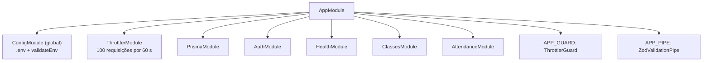

# Src do backend

Esta pasta contém o **código-fonte da API NestJS**: o ponto de entrada, o módulo raiz e as pastas de cada responsabilidade.

---

## Arquivos e pastas

| Arquivo / pasta | Responsabilidade |
|---|---|
| `main.ts` | Inicializa a aplicação: prefixo global, CORS, cabeçalhos de segurança, filtros, interceptors, Swagger e porta. |
| `app.module.ts` | Módulo raiz. Importa os demais módulos e registra os guards e pipes globais. |
| `common/` | Recursos compartilhados: autenticação, exceções, filtros, interceptors, paginação e decoradores. |
| `config/` | Configurações e validação das variáveis de ambiente. |
| `database/` | Acesso ao banco pelo Prisma. |
| `modules/` | Módulos de negócio: `attendance`, `classes` e `health`. |

---

## Inicialização (`main.ts`)

| Item | Comportamento |
|---|---|
| Prefixo global | Lido de `API_PREFIX`. Padrão: `frequencia/api`. |
| Rotas excluídas do prefixo | `health` e `<prefixo>/health`. |
| CORS | Ativado só se `CORS_ORIGINS` estiver definido. A lista é separada por vírgula e as credenciais são permitidas. |
| Cabeçalhos de segurança | `helmet`. |
| Filtro global | `HttpExceptionFilter`, que padroniza os erros. |
| Interceptor global | `TransformInterceptor`, que envelopa as respostas de sucesso. |
| Swagger | Disponível em `SWAGGER_PATH` (padrão `api/docs`), com autenticação Bearer. Título, descrição e versão vêm de `SWAGGER_TITLE`, `SWAGGER_DESCRIPTION` e `SWAGGER_VERSION`. |
| Porta | Lida de `PORT`. Padrão: `3000`. |

Se o bootstrap falhar, o erro é registrado e o processo termina com código `1`.

---

## Módulo raiz (`app.module.ts`)

- `ConfigModule` é global e carrega as configurações de banco, Swagger e Keycloak.
- `ThrottlerGuard` limita as requisições em todas as rotas.
- `ZodValidationPipe` valida o corpo e os parâmetros com os schemas Zod.

---

> Observações
>
> - A ordem das importações não é arbitrária: `PrismaModule` e `AuthModule` precisam existir antes dos módulos de negócio que os usam.
> - Mudar o prefixo global altera todas as URLs da API. Os clientes do frontend usam o mesmo valor em `VITE_API_URL`.
