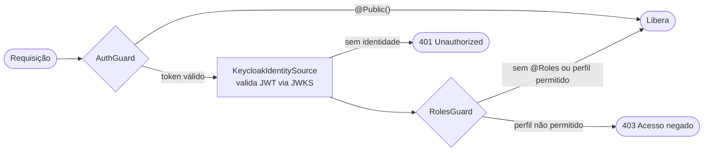

# Common — recursos compartilhados do backend

Esta pasta reúne o que é **usado por mais de um módulo**: autenticação e autorização, decoradores, exceções, filtro de erros, interceptor de resposta e paginação.

---

## Estrutura

| Subpasta / arquivo | Função |
|---|---|
| `auth/` | Autenticação via Keycloak, guardas e decoradores de usuário e perfil. |
| `auth/access-role.enum.ts` | Perfis do sistema: `ADMIN`, `PROFESSOR` e `STUDENT`. |
| `auth/current-user.interface.ts` | Formato do usuário autenticado: `userId` e `role`. |
| `auth/identity/` | Interface `IdentitySource` e a implementação `KeycloakIdentitySource`, que valida o JWT. |
| `auth/guards/auth.guard.ts` | Exige identidade válida em todas as rotas, exceto as marcadas com `@Public()`. |
| `auth/guards/roles.guard.ts` | Aplica os perfis exigidos por `@Roles(...)`. Sem `@Roles`, a rota fica liberada. |
| `auth/decorators/` | `@Roles(...)` e `@GetCurrentUser()`. |
| `decorators/public.decorator.ts` | `@Public()`, que dispensa autenticação na rota. |
| `exceptions/` | `AppException`, `AccessDeniedException`, `ResourceNotFoundException` e o enum `ErrorCode`. |
| `filters/` | `HttpExceptionFilter`, que converte erros em Problem Details. |
| `interceptors/transform.interceptor.ts` | Interceptor global de resposta. |
| `pagination/` | DTOs de paginação: query validada com Zod e envelope de resposta paginada. |

---

## Fluxo de autenticação

1. O `AuthGuard`, registrado globalmente em `AuthModule`, chama `KeycloakIdentitySource.extract()`.
2. O token é validado com `jose`: assinatura pelo JWKS do realm, `issuer` do realm e cliente esperado (`aud` ou `azp`).
3. O papel do token vira o `CurrentUser` em `request.user`.
4. O `RolesGuard` confere o papel exigido pela rota, se houver `@Roles(...)`.

---

## Erros

Os erros seguem o formato Problem Details. Os códigos internos ficam em `exceptions/error-code.enum.ts`:

`NOT_FOUND`, `VALIDATION_FAILED`, `ACCESS_DENIED`, `CONFLICT`, `EXTERNAL_SERVICE_UNAVAILABLE`, `INTERNAL_ERROR`.

---

## Quem usa

- Os módulos de `src/modules/` usam `GetCurrentUser()` e os tipos de `auth/`.
- As configurações do Keycloak vêm de `src/config/keycloak.config.ts`.
