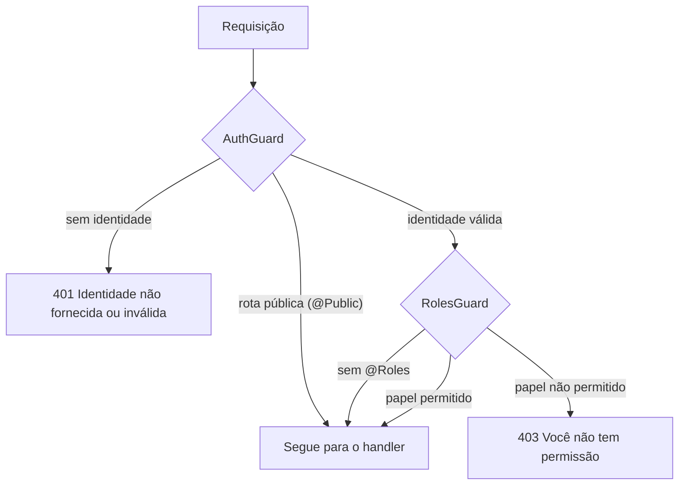

# Auth — autenticação e autorização

Esta pasta contém a **autenticação** (quem é o usuário, validando o token do Keycloak) e a **autorização por papel** (o que ele pode acessar). É a camada que protege todas as rotas da API.

---

## Estrutura

| Arquivo / pasta | Responsabilidade |
|---|---|
| `auth.module.ts` | Registra a fonte de identidade e os dois guards globais. |
| `access-role.enum.ts` | Papéis internos: `ADMIN`, `PROFESSOR` e `STUDENT`. |
| `current-user.interface.ts` | Formato do usuário autenticado: `userId` e `role`. |
| `identity/identity-source.interface.ts` | Contrato `IdentitySource` e o token `IDENTITY_SOURCE`. |
| `identity/keycloak.identity-source.ts` | Implementação que valida o JWT do Keycloak. |
| `guards/auth.guard.ts` | Exige identidade válida, exceto em rotas públicas. |
| `guards/roles.guard.ts` | Confere o papel exigido pela rota. |
| `decorators/roles.decorator.ts` | `@Roles(...)`, que define os papéis aceitos na rota. |
| `decorators/current-user.decorator.ts` | `@GetCurrentUser()`, que entrega o usuário autenticado ao handler. |

---

## Fluxo de uma requisição

1. `AuthGuard` pede a identidade à fonte (`KeycloakIdentitySource`). Se a rota for pública, nada é verificado.
2. Sem identidade, a resposta é `401`. Com identidade, o usuário é gravado em `request.user`.
3. `RolesGuard` lê os papéis de `@Roles(...)`. Sem papéis definidos, a rota fica liberada para qualquer usuário autenticado.

---

## Validação do token (`KeycloakIdentitySource`)

| Etapa | Regra |
|---|---|
| Cabeçalho | Precisa ser `Authorization: Bearer <token>`. Outro formato resulta em "sem identidade". |
| Assinatura e emissor | Verificada com as chaves públicas do realm (JWKS). O emissor é `<KEYCLOAK_AUTH_SERVER_URL>/realms/<KEYCLOAK_REALM>`. |
| Expiração | Tolerância de 5 segundos entre o relógio do Keycloak e o da API. |
| Cliente (audiência) | O `KEYCLOAK_CLIENT_ID` precisa aparecer em `aud` ou em `azp`. Se não estiver configurado, a verificação é pulada. |
| Usuário | O campo `sub` é obrigatório. Sem ele, a resposta é `401`. |
| Papel | Lido de `realm_access.roles`. Mapeamento: `p07-admin` para `ADMIN`, `p07-professor` para `PROFESSOR` e `p07-student` para `STUDENT`. Se houver mais de um, vale a prioridade ADMIN, PROFESSOR, STUDENT. Sem papel reconhecido, a resposta é `403`. |

Erros de token inválido ou expirado retornam `401` com a mensagem "Token inválido ou expirado.". Token emitido para outro cliente retorna `403`.

A chave pública do Keycloak é carregada na primeira validação, não na inicialização da aplicação. O cache e o timeout vêm de `keycloak.jwksCacheMaxAge` e `keycloak.jwksTimeout`.

---

## Papéis (`access-role.enum.ts`)

| Valor | Uso |
|---|---|
| `ADMIN` | Acesso administrativo, com visão de todas as turmas. |
| `PROFESSOR` | Gestão das turmas vinculadas. |
| `STUDENT` | Consulta e registro de presença nas turmas matriculadas. |

As regras de vínculo por turma não estão aqui. Elas ficam em `modules/classes/class-access.ts`.

---

> Observações
>
> - O `AuthGuard` e o `RolesGuard` são registrados com `APP_GUARD`, então valem para todas as rotas, a não ser que a rota seja marcada com `@Public()`.
> - Os testes unitários em `backend/tests/unit/auth.test.ts` cobrem rota pública, identidade ausente, identidade válida, papel permitido e papel negado.
> - Se a configuração do Keycloak estiver incompleta, a validação lança erro de configuração no primeiro token recebido. O `validateEnv` já sinaliza isso no boot quando `KEYCLOAK_AUTH_SERVER_URL` ou `KEYCLOAK_REALM` estiverem definidos sem o outro.
