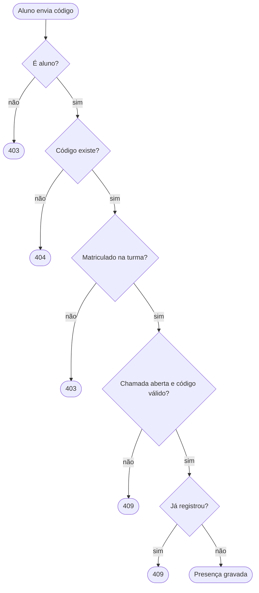

# Módulo attendance — chamadas e presenças

Este módulo controla a **abertura de chamadas**, o **registro de presença pelo aluno**, o **encerramento** e a **correção manual** pelo professor.

---

## Arquivos

| Arquivo | Responsabilidade |
|---|---|
| `attendance.controller.ts` | Rotas HTTP do módulo. |
| `attendance.service.ts` | Regras de negócio: `list`, `open`, `close`, `register` e `correct`. |
| `attendance.dto.ts` | Validação de entrada com Zod: duração, código e status. |
| `call-view.ts` | Monta a resposta da chamada e define o que cada perfil pode ver. |
| `attendance.module.ts` | Registra o controller e o service. |

---

## Rotas

| Método | Caminho | Quem pode | Ação |
|---|---|---|---|
| `GET` | `/calls` | Quem tem acesso à turma (admin vê todas) | Lista chamadas, com filtro opcional `classId`. |
| `POST` | `/classes/:id/calls` | Professor da turma ou admin | Abre chamada com `{ "minutes": 1 a 120 }`. |
| `POST` | `/calls/:id/close` | Professor da turma ou admin | Encerra a chamada. |
| `POST` | `/attendance` | Aluno | Registra presença com `{ "code": "ABC123" }`. |
| `PATCH` | `/calls/:id/attendance/:studentId` | Professor da turma ou admin | Define `presente` ou `ausente`. |

---

## Fluxo de registro de presença

---

## Regras detalhadas

<b> Abrir chamada (open)</b>

 

- Só uma chamada aberta por turma. Se já houver uma, a resposta é conflito (`409`).
- Gera um código de 6 caracteres hexadecimais em maiúsculas e define a validade em minutos.
- Roda em transação com bloqueio da turma (`SELECT ... FOR UPDATE`). Em caso de colisão, tenta de novo até três vezes.
- Grava `CALL_OPENED` no `AuditLog`.

<b> Registrar presença (register)</b>

 

- Só alunos registram. Outros perfis recebem `403`.
- O aluno precisa estar matriculado na turma da chamada.
- Rejeita código inexistente, chamada encerrada, código expirado e presença já registrada.
- O código é compartilhado pela turma, por isso não é marcado como usado após o primeiro registro.
- A identidade do aluno vem do token, nunca do corpo da requisição.

<b> Encerrar chamada (close)</b>

 

- Marca `closedAt` e o status `CLOSED`. Se a chamada já estiver encerrada, devolve a própria chamada sem erro.
- Expirar o código não encerra a chamada. Só o professor encerra.

<b> Corrigir presença (correct)</b>

 

- O professor altera a situação de qualquer aluno matriculado, inclusive depois do encerramento.
- Guarda quem alterou (`markedBy`) e quando (`markedAt`), e registra antes e depois no `AuditLog`.

---

## Privacidade na resposta (`call-view.ts`)

| Perfil | Campo `code` | Campo `records` |
|---|---|---|
| Professor e admin | Código atual da chamada | Situação de todos os alunos |
| Aluno | Vazio | Apenas o próprio registro |

---

## Dependências

- `classes/class-access.ts`: valida o acesso à turma e a permissão de gestão.
- `database/prisma.service.ts`: acesso ao banco.
- `common/auth/`: usuário atual e perfis.
