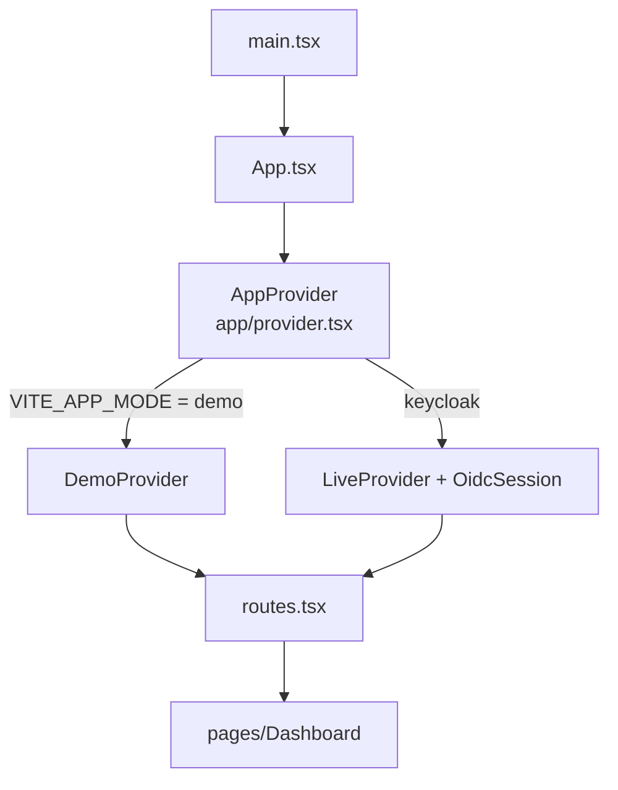

# Src — código-fonte do frontend

Esta pasta contém o **código da aplicação React**: ponto de entrada, rotas, estilos e as fachadas que organizam os imports entre os módulos.

---

## Arquivos e pastas

| Arquivo / pasta | Responsabilidade |
|---|---|
| `main.tsx` | Ponto de entrada. Cria a raiz com `createRoot`, envolve a app em `StrictMode` e importa `styles.css`. |
| `App.tsx` | Compõe o `AppProvider` (sessão) com o `RouteMap` (rotas). |
| `routes.tsx` | Mapa de rotas (ver abaixo). |
| `attendance.ts` | Fachada que reexporta tipos e funções de `modules/attendance/`, preservando os imports antigos. |
| `integration.ts` | Fachada da API: funções de chamadas, turmas e alunos, além da leitura do envelope `{ success, data }`. |
| `styles.css` | Estilos globais e tokens de design, com comentário de origem no Figma. |
| `app/` | Sessão, provider de autenticação e modo de demonstração. |
| `assets/figma/` | 20 ícones SVG usados pelo `DesignIcon`. |
| `components/` | Componentes compartilhados: `ErrorBoundary`, layout e elementos de interface. |
| `config/` | Leitura das variáveis de ambiente do frontend. |
| `hooks/` | Hooks de estado: `useAttendance` e `useClasses`. |
| `modules/` | Módulos de domínio: `attendance` e `classes`. |
| `pages/` | Telas: Dashboard, aluno, professor e visão do admin. |
| `services/` | Cliente HTTP `api.ts`. |
| `utils/` | Configuração OIDC e formatação de data. |

---

## Rotas

| Caminho | Comportamento |
|---|---|
| `/` | Redireciona para `/<perfil>` do usuário logado. |
| `/:profile` | Só abre se o perfil da URL for o mesmo da sessão. Caso contrário mostra "Acesso indisponível". Perfil inválido mostra "Página não encontrada". |
| `*` | "Página não encontrada", com link para o início. |

A página de perfil fica dentro de um `ErrorBoundary` com `resetKey` igual ao perfil, então um erro numa tela não trava a navegação.

---

## Fluxo de inicialização

---

> **Observações**
>
> - Os imports dos módulos devem passar pelas fachadas `attendance.ts` e `integration.ts`, para que a estrutura interna possa mudar sem quebrar as telas.
> - `styles.css` é global. Qualquer alteração de token afeta todas as telas.
