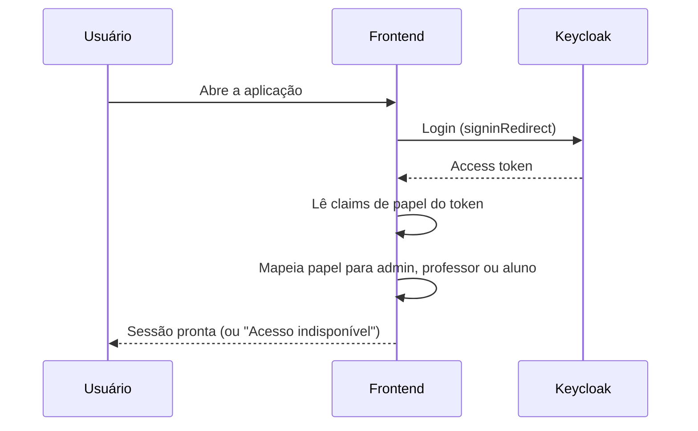

# App — sessão e provedores

Esta pasta define **quem é o usuário** na interface. Há dois modos: **demonstração** (perfil escolhido na tela) e **Keycloak** (login real via OIDC).

---

## Arquivos

| Arquivo | Responsabilidade |
|---|---|
| `session.tsx` | Tipos `Role` (`admin`, `professor`, `aluno`), `Session`, `roleLabels`, `isRole`, `SessionContext` e o hook `useSession`. |
| `provider.tsx` | `AppProvider`, que escolhe `DemoProvider` ou `LiveProvider` conforme `VITE_APP_MODE`, e envolve tudo em `ErrorBoundary`. |

---

## Modo demonstração (`DemoProvider`)

- O perfil vem de `?perfil=` na URL ou do último segmento do caminho. Sem valor válido, o padrão é `professor`.
- Para `aluno`, a sessão usa o aluno de demonstração (`demoStudent`).
- `switchRole` troca o perfil em tempo de execução, usado pelo seletor da `TopBar`.

---

## Modo Keycloak (`LiveProvider` + `OidcSession`)

- O papel é lido das claims `realm_access` e `resource_access` do access token.
- Os nomes dos papéis podem ser ajustados por `VITE_ROLE_ADMIN`, `VITE_ROLE_PROFESSOR` e `VITE_ROLE_ALUNO`. Os padrões são `ADMIN`, `PROFESSOR` e `STUDENT`.
- Sem papel reconhecido, a tela mostra "Acesso indisponível" e um botão para sair.
- Ao expirar o token ou falhar a renovação silenciosa, a sessão é encerrada.
- Os eventos do `react-oidc-context` são ligados ao cliente da API (`services/api.ts`) para manter o token atualizado.

---

>  **Atenção**
>
> - O frontend lê as claims só para decidir a tela. Quem autoriza de fato é a API.
> - O login usa `response_type: code` com renovação silenciosa automática. A configuração está em `utils/auth.ts`.
