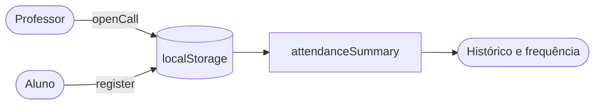

# Módulo attendance (frontend) — chamadas e presenças

Este módulo reúne o que a interface precisa para **abrir chamadas**, **registrar presença**, **mostrar o histórico** e **calcular a frequência**. Hoje roda principalmente no **modo demonstração**, com dados guardados no navegador.

---

## Estrutura

| Arquivo / pasta | Responsabilidade |
|---|---|
| `domain/constants.ts` | Limites do contrato: 1 a 120 minutos, código de 3 bytes (6 caracteres hexadecimais) e constantes de tempo. |
| `domain/rules.ts` | Regras puras: `openCall`, `register` e `timeLeft`. |
| `domain/types.ts` | Tipos: `Status`, `Student`, `Class` e `Call`. |
| `summary.ts` | `attendanceSummary`: aulas encerradas, presenças, faltas e percentual. |
| `storage.ts` | Lê e grava as chamadas no `localStorage`, com `navigator.locks`. |
| `demoData.ts` | Turmas e alunos fictícios do modo demonstração. |
| `StudentHistory.tsx` | Histórico de presença do aluno, com filtro por turma. |
| `components/TeacherCallCard.tsx` | Gera o código, mostra a validade, projeta e encerra a chamada. |
| `components/AttendanceRoster.tsx` | Lista de alunos da turma e ajuste manual pelo professor. |
| `components/StudentCheckIn.tsx` | Campo para o aluno digitar o código. |
| `components/StudentSummary.tsx` | Cards de frequência geral e de aulas encerradas. |
| `components/TokenProjection.tsx` | Janela de projeção em tela cheia, com código e contagem regressiva. |
| `components/TokenValidity.tsx` | Tempo restante do código, atualizado a cada segundo. |

---

## Como funciona

- O professor abre a chamada com a turma e a validade. `openCall` gera o código e impede uma segunda chamada aberta na mesma turma.
- O aluno digita o código. `register` valida existência, janela de tempo, matrícula e se ele ainda não registrou presença.
- A frequência considera **somente chamadas encerradas**. Chamadas abertas aparecem como "Pendente".
- Ao encerrar, o professor corrige a situação de cada aluno pelo `AttendanceRoster`.

---

## Relação com o restante do frontend

- `src/attendance.ts` é a fachada que reexporta tipos e funções deste módulo, preservando os imports antigos.
- `TeacherDashboard.tsx` e `StudentDashboard.tsx` montam os componentes deste módulo.
- Cards de turmas e agenda ficam em `src/modules/classes/`.

---

> **Atenção**
>
> - A chave `frequencia-ufpe:demo:v1` do `storage.ts` identifica os dados de demonstração. Mudá-la faz os dados salvos no navegador deixarem de aparecer.
> - No modo Keycloak, o estado vem da API. As regras de demonstração não substituem as validações do backend.
> - Mudanças nos limites de `constants.ts` exigem revisar os critérios de aceitação.
