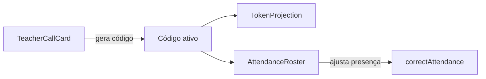

# Attendance components — componentes da chamada

Esta pasta tem os **componentes visuais** do módulo de presença. Eles recebem dados e funções por props e não acessam a API nem o `localStorage` diretamente.

---

## Arquivos

| Arquivo | Quem usa | Responsabilidade |
|---|---|---|
| `TeacherCallCard.tsx` | Professor e admin | Escolhe a turma, define a validade, gera o código, projeta e encerra a chamada. |
| `AttendanceRoster.tsx` | Professor e admin | Lista os alunos com a situação de cada um e permite ajustar. |
| `TokenProjection.tsx` | Professor e admin | Janela em tela cheia com o código e o tempo restante. |
| `StudentCheckIn.tsx` | Aluno | Campo de 6 caracteres para digitar o código e enviar. |
| `StudentSummary.tsx` | Aluno | Cards de frequência geral e de aulas encerradas. |
| `TokenValidity.tsx` | Aluno | Tempo restante do código da aula, atualizado a cada segundo. |

---

## Lado do professor

- `TeacherCallCard` desativa a geração enquanto houver uma chamada aberta. O botão "Projetar" fica desativado depois que o código expira.
- `AttendanceRoster` mostra a chamada escolhida no seletor. Para chamada encerrada, a lista mostra "Ausente" para quem não registrou presença.

---

## Lado do aluno

- `StudentCheckIn` aceita só letras maiúsculas e números, e bloqueia colar o código. O botão fica desativado até o código ter 6 caracteres.
- `TokenValidity` mostra "Encerrado" para chamada fechada, o tempo restante para chamada aberta, ou um traço sem chamada selecionada.
- `StudentSummary` mostra o percentual, o número de faltas e de aulas, com base nas chamadas encerradas.

---

 **Atenção**
>
> - `TokenProjection` usa `dialog` com `showModal()`. Ao fechar, a janela é removida pelo cleanup do efeito.
> - Os textos da interface estão em português e os nomes dos componentes em inglês, como no restante do código.
