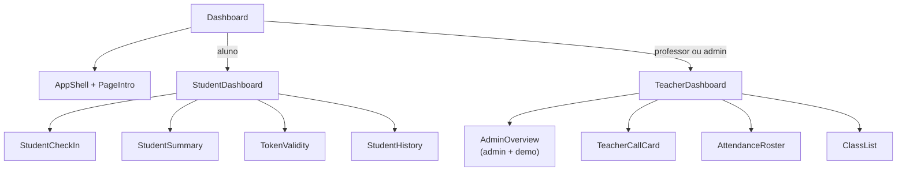

# Pages — telas da aplicação

Esta pasta contém as **telas completas**. Cada página monta componentes de `components/` e `modules/`, e pega dados dos hooks.

---

## Arquivos

| Arquivo | Responsabilidade |
|---|---|
| `Dashboard.tsx` | Casca da tela: `AppShell`, saudação e escolha entre aluno e professor/admin. Guarda o texto da busca. |
| `StudentDashboard.tsx` | Tela do aluno: registrar presença, resumo, turmas, validade do código, atalhos, próximas aulas e histórico. |
| `TeacherDashboard.tsx` | Tela do professor e do admin: abrir e encerrar chamada, projeção, lista de alunos e turmas. |
| `AdminOverview.tsx` | Métricas e tabela de turmas. Só aparece no modo demonstração. |

---

## Como as telas se montam

---

## StudentDashboard

- Envia o código pelo `StudentCheckIn` e, em caso de sucesso, guarda a chamada para mostrar a validade.
- Mostra turmas do aluno e a frequência de cada uma (`ClassList`), e o histórico detalhado com filtro por turma.
- Ao clicar em uma turma, rola a página até a seção de frequência.

---

## TeacherDashboard

- Escolhe a turma, a validade em minutos (de 1 a 120) e gera o código. Enquanto a chamada está aberta, o cronômetro atualiza a cada 250 ms.
- Projeta o código em tela cheia (`TokenProjection`) enquanto ele não expirou.
- Carrega os alunos pela API no modo Keycloak. Na demonstração, usa os alunos da turma.
- Ajusta a presença de cada aluno pela lista. Só a chamada exibida pode ser ajustada.
- Ao encerrar a chamada, fecha a projeção.

---

## AdminOverview

- Mostra o total de turmas, alunos distintos, professores distintos e chamadas abertas.
- Lista cada turma com o professor (ou "A definir") e o número de alunos.

---

> **Atenção**
>
> - `TeacherDashboard` é usado tanto por professor quanto por admin. A diferença é o título da lista de turmas e a visão geral da demonstração.
> - Os textos de busca vêm de `Dashboard` e são repassados para `ClassList`.
