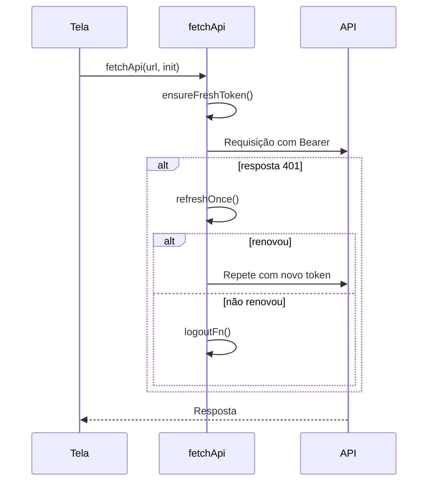

# Services — cliente HTTP da API

Esta pasta tem o **cliente `fetch`** que fala com o backend. Ele cuida do token de autenticação, da renovação e dos erros, para que as telas não precisem fazer isso.

---

## Arquivo

| Arquivo | Responsabilidade |
|---|---|
| `api.ts` | `fetchApi`, gestão do token, renovação, logout e leitura de erros. |

---

## Gestão do token

| Função | O que faz |
|---|---|
| `setAuthToken(token)` | Guarda o token e lê a data de expiração dele (`exp`). |
| `getAuthToken()` | Devolve o token atual. |
| `setRefreshTokenFn(fn)` | Define como renovar o token (usada pelo provider OIDC). |
| `setLogoutFn(fn)` | Define o que fazer quando a sessão morre. |
| `ensureFreshToken()` | Renova antes da requisição se o token vence em menos de 5 segundos. |

---

## Fluxo de uma requisição

- As renovações simultâneas são compartilhadas (`refreshOnce`), para não abrir várias renovações ao mesmo tempo.
- `getApiErrorMessage(response, fallback)` lê `detail`, `message` ou `error` do corpo. Se não houver, usa o texto puro ou a mensagem padrão.

---

>  **Observações**
>
> - Este arquivo não valida a assinatura do token. Quem valida é o backend. O cliente só lê a data de expiração.
> - As funções de endpoint (`loadClasses`, `createCall` etc.) ficam em `src/integration.ts`, que usa este cliente.
